---
title: "IEAP Series 04 – RStudio Assignment"
author: "Werner BINCHE, Elouan DEFFIN, Vidusha THEBUWANA"
date: "2026-11-07"
date-format: "YYYY-MM-DD"
format: 
  html: 
    embed-resources: true
    keep-md: true
bibliography: references.bib
csl: https://www.zotero.org/styles/apa
---

Github Link: https://github.com/ElouanDef/IEAP-Series04-RStudio

# Introduction

## Introduction

Linear regression is a statistical method used to describe and analyse the relationship between two variables. It allows us to estimate a linear trend and make predictions based on observed data. However, real-world measurements often contain random noise, which can influence the accuracy and reliability of regression models.

The first part of this study is to investigate how different levels of random noise affect linear regression. Three synthetic datasets will be generated using the same underlying linear relationship but with different levels of random variability. The resulting regression models will then be compared using numerical indicators and graphical representations to evaluate the impact of noise on parameter estimation, explained variance and prediction accuracy.

The second part focuses on modelling heart rate recovery after exercise using real physiological data. Linear, mono-exponential, and, when justified, bi-exponential models are evaluated to determine which best describes the decrease in heart rate over time. Model performance is assessed through goodness-of-fit indicators, residual analysis, and physiological interpretation.

Together, these two analyses aim to demonstrate how data variability and model selection influence the interpretation and reliability of regression results.


# Part 2 – Linear regression and random noise

## Formulate your expectations

Before running the simulations, we expect that increasing the level of random noise will make the observed data more dispersed around the underlying linear relationship.

- **Estimated slope and intercept:** The estimated coefficients may differ from their theoretical values because random noise affects the position of the observations. With higher noise, these estimates are expected to become less reliable.
- **Prediction quality:** Predictions are expected to become less accurate as the noise increases, because the observations will be further away from the fitted regression line.
- **Explained variance (R²):** We expect the coefficient of determination to decrease as the noise level increases, since the linear model will explain a smaller proportion of the total variability in the data.

The three estimated linear relationships are therefore not expected to be exactly identical, even though they share the same underlying theoretical relationship. Random variations in the generated data will lead to differences between the fitted regression models.


## Implement and investigate


::: {.cell}

```{.r .cell-code}
# Generate the x values
set.seed(123)

n <- 100
x <- seq(0, 10, length.out = n)

# Define the theoretical linear relationship
y_theoretical <- 2 * x + 5

# Generate three datasets with different noise levels
data_low <- data.frame(
  x = x,
  y = y_theoretical + rnorm(n, mean = 0, sd = 2),
  Noise = "Low noise"
)

data_medium <- data.frame(
  x = x,
  y = y_theoretical + rnorm(n, mean = 0, sd = 5),
  Noise = "Medium noise"
)

data_high <- data.frame(
  x = x,
  y = y_theoretical + rnorm(n, mean = 0, sd = 10),
  Noise = "High noise"
)

# Combine the three datasets
data_all <- rbind(data_low, data_medium, data_high)

# Display the first observations
head(data_all)
```

::: {.cell-output .cell-output-stdout}

```
          x        y     Noise
1 0.0000000 3.879049 Low noise
2 0.1010101 4.741665 Low noise
3 0.2020202 8.521457 Low noise
4 0.3030303 5.747077 Low noise
5 0.4040404 6.066656 Low noise
6 0.5050505 9.440231 Low noise
```


:::
:::


::: {.cell}

```{.r .cell-code}
# Fit a linear regression model for each dataset

model_low <- lm(y ~ x, data = data_low)
model_medium <- lm(y ~ x, data = data_medium)
model_high <- lm(y ~ x, data = data_high)

# Display the results of each model

summary(model_low)
```

::: {.cell-output .cell-output-stdout}

```

Call:
lm(formula = y ~ x, data = data_low)

Residuals:
    Min      1Q  Median      3Q     Max 
-4.9071 -1.1047 -0.0692  1.2970  4.1897 

Coefficients:
            Estimate Std. Error t value Pr(>|t|)    
(Intercept)  4.93221    0.36309   13.58   <2e-16 ***
x            2.04972    0.06273   32.67   <2e-16 ***
---
Signif. codes:  0 '***' 0.001 '**' 0.01 '*' 0.05 '.' 0.1 ' ' 1

Residual standard error: 1.829 on 98 degrees of freedom
Multiple R-squared:  0.9159,	Adjusted R-squared:  0.9151 
F-statistic:  1068 on 1 and 98 DF,  p-value: < 2.2e-16
```


:::

```{.r .cell-code}
summary(model_medium)
```

::: {.cell-output .cell-output-stdout}

```

Call:
lm(formula = y ~ x, data = data_medium)

Residuals:
    Min      1Q  Median      3Q     Max 
-9.4803 -3.3440 -0.3869  2.8039 16.5268 

Coefficients:
            Estimate Std. Error t value Pr(>|t|)    
(Intercept)   3.6696     0.9602   3.822 0.000233 ***
x             2.1585     0.1659  13.012  < 2e-16 ***
---
Signif. codes:  0 '***' 0.001 '**' 0.01 '*' 0.05 '.' 0.1 ' ' 1

Residual standard error: 4.837 on 98 degrees of freedom
Multiple R-squared:  0.6334,	Adjusted R-squared:  0.6296 
F-statistic: 169.3 on 1 and 98 DF,  p-value: < 2.2e-16
```


:::

```{.r .cell-code}
summary(model_high)
```

::: {.cell-output .cell-output-stdout}

```

Call:
lm(formula = y ~ x, data = data_high)

Residuals:
    Min      1Q  Median      3Q     Max 
-19.445  -6.400  -1.457   6.374  22.692 

Coefficients:
            Estimate Std. Error t value Pr(>|t|)    
(Intercept)   4.2964     1.8820   2.283   0.0246 *  
x             2.3817     0.3252   7.325 6.79e-11 ***
---
Signif. codes:  0 '***' 0.001 '**' 0.01 '*' 0.05 '.' 0.1 ' ' 1

Residual standard error: 9.481 on 98 degrees of freedom
Multiple R-squared:  0.3538,	Adjusted R-squared:  0.3472 
F-statistic: 53.65 on 1 and 98 DF,  p-value: 6.79e-11
```


:::
:::


::: {.cell}

```{.r .cell-code}
# Compare the three regression models

results <- data.frame(
  Noise = c("Low", "Medium", "High"),
  Intercept = c(
    coef(model_low)[1],
    coef(model_medium)[1],
    coef(model_high)[1]
  ),
  Slope = c(
    coef(model_low)[2],
    coef(model_medium)[2],
    coef(model_high)[2]
  ),
  R_squared = c(
    summary(model_low)$r.squared,
    summary(model_medium)$r.squared,
    summary(model_high)$r.squared
  ),
  Residual_error = c(
    sigma(model_low),
    sigma(model_medium),
    sigma(model_high)
  )
)

results
```

::: {.cell-output .cell-output-stdout}

```
   Noise Intercept    Slope R_squared Residual_error
1    Low  4.932214 2.049719 0.9159275       1.829070
2 Medium  3.669611 2.158531 0.6333722       4.837054
3   High  4.296372 2.381656 0.3537807       9.480720
```


:::
:::


::: {.cell}

```{.r .cell-code}
# Plot the three datasets and their regression lines

library(ggplot2)

ggplot(data_all, aes(x = x, y = y, color = Noise)) +
  geom_point(alpha = 0.6) +
  geom_smooth(method = "lm", se = FALSE) +
  geom_abline(
    intercept = 5,
    slope = 2,
    color = "black",
    linetype = "dashed"
  ) +
  labs(
    title = "Effect of random noise on linear regression",
    x = "X",
    y = "Y",
    color = "Noise level"
  ) +
  theme_minimal()
```

::: {.cell-output-display}
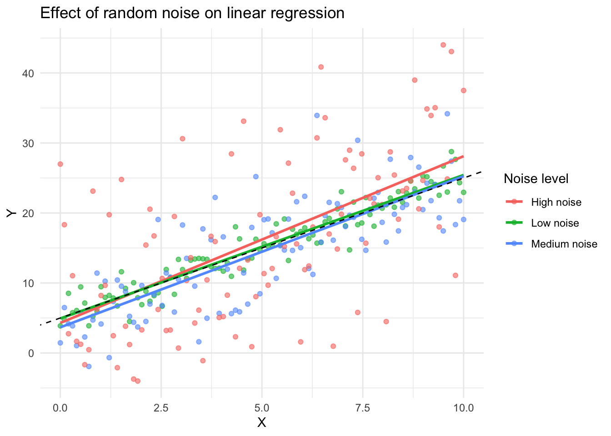{width=672}
:::
:::


## Draw conclusions

The results are consistent with our initial expectations. Increasing the level of random noise leads to a greater dispersion of the data points around the regression line.

The coefficient of determination (R²) decreases from 0.916 with low noise to 0.633 with medium noise and 0.354 with high noise. This shows that the linear model explains a smaller proportion of the variability in the data as noise increases.

The residual standard error also increases from 1.829 to 9.481, indicating that the predictions become less accurate.

The estimated slopes and intercepts are not exactly identical between the three models. However, they remain relatively close to the theoretical values of 2 for the slope and 5 for the intercept.

Overall, random noise does not remove the underlying linear relationship, but it makes it more difficult to estimate accurately and reduces the predictive quality of the regression model.

## Propose a better numerical experiment

To improve the numerical experiment, we could repeat the simulation 500 times for each noise level while keeping the same theoretical linear relationship and the same x values.

For each simulation, we would calculate the estimated slope, intercept, R² and residual standard error. We could then calculate the average and standard deviation of these indicators for each noise level.

This method would reduce the influence of random variations from a single simulation and provide a more reliable comparison. We would expect the average slope and intercept to remain close to their theoretical values, while the variability of the estimates and the prediction errors would increase with the noise level.


# Part 3 – Heart rate recovery

## Formulate predictions from scientific literature

### Mathematical models

Heart rate recovery (HRR) after exercise has been described using mathematical models, particularly exponential decay models [@bartels2018; @bartelsferreira2015].

A mono-exponential model describes a rapid initial decrease in heart rate followed by a progressively slower decrease. Bartels-Ferreira et al. (2015) demonstrated that this model can adequately describe heart rate recovery after resistance exercise, provided that the recording period is sufficiently long.

Bartels et al. (2018) also described two distinct phases of recovery: a fast phase and a slow phase. Their study proposed a method to identify the transition between these phases.

These findings suggest that non-linear models may be more appropriate than a simple linear regression. A bi-exponential model could also be investigated to represent two recovery components, although its superiority must be demonstrated using the data.

### Physiological mechanisms

The decrease in heart rate after exercise is mainly explained by changes in the activity of the autonomic nervous system [@bartels2018].

Two mechanisms contribute to this recovery:

Parasympathetic reactivation: responsible for much of the rapid decrease in heart rate immediately after exercise.

Sympathetic withdrawal: contributes to the slower decrease during the later recovery period, together with parasympathetic activity.

These mechanisms do not act at exactly the same speed, which helps explain why heart rate recovery is not constant over time.

### Expected characteristics of the recovery curve 

Based on the literature, we expect the recovery curve to show:

A rapid initial decrease in heart rate immediately after exercise.

A slower decrease during the following minutes.

A progressive flattening of the curve as heart rate approaches a lower value.

Differences depending on exercise intensity, since Bartels et al. (2018) observed that the transition between recovery phases occurred later after high-intensity exercise.

Therefore, we expect the recovery curve to be non-linear rather than a straight line.

### Is one model sufficient for the whole recovery? 

The literature suggests that a single model may not always describe every characteristic of heart rate recovery.

Bartels-Ferreira et al. (2015) showed that a mono-exponential model can adequately represent recovery after resistance exercise. However, the estimated time constant and the quality of the model depend on the duration of the recording.

Furthermore, Bartels et al. (2018) identified two recovery phases with different physiological mechanisms.

These findings suggest that a mono-exponential model may be sufficient for some recovery periods, while a more complex model could be useful in other situations.

However, the presence of two physiological phases does not necessarily mean that a bi-exponential model will provide a better fit.

Our hypotheses 

### Based on these two studies, we formulate the following hypotheses for the two recordings:

H1: We expect heart rate to decrease rapidly immediately after exercise, followed by a slower decrease. Therefore, the linear model is expected to provide a poorer fit than the exponential models.

H2: We expect the mono-exponential model to describe the general shape of heart rate recovery better than the linear model, particularly when a sufficiently long recovery period is available [@bartelsferreira2015].

H3: We hypothesize that a bi-exponential model could better represent the fast and slow phases of recovery. However, this improvement may not be sufficient to justify the additional model complexity [@bartels2018].

H4: We expect the best-fitting model to depend on the characteristics of each recording, particularly the duration of the actual recovery period and the shape of the heart rate curve. Therefore, the same model may not be optimal for both datasets.


## Test your predictions using the datasets


::: {.cell}

```{.r .cell-code}
# Identify the two ZIP archives
zip_files <- list.files(
  "data",
  pattern = "\\.zip$",
  full.names = TRUE
)

# Identify each recording
zip_long <- zip_files[grepl("3h10m", zip_files)]
zip_short <- zip_files[grepl("7m30s", zip_files)]

# Import pulse data directly from the ZIP archives
pulse_long <- read.csv(unz(zip_long, "pulse.csv"))
pulse_short <- read.csv(unz(zip_short, "pulse.csv"))
```
:::


::: {.cell}

```{.r .cell-code}
# Convert timestamps into elapsed time (minutes)
pulse_long$time_min <- (pulse_long$timestamp - min(pulse_long$timestamp)) / 60000
pulse_short$time_min <- (pulse_short$timestamp - min(pulse_short$timestamp)) / 60000

# Plot the long recording
plot(pulse_long$time_min, pulse_long$value,
     type = "l",
     col = "blue",
     xlab = "Time (minutes)",
     ylab = "Heart rate (bpm)",
     main = "Heart rate - 3h10 recording")
```

::: {.cell-output-display}
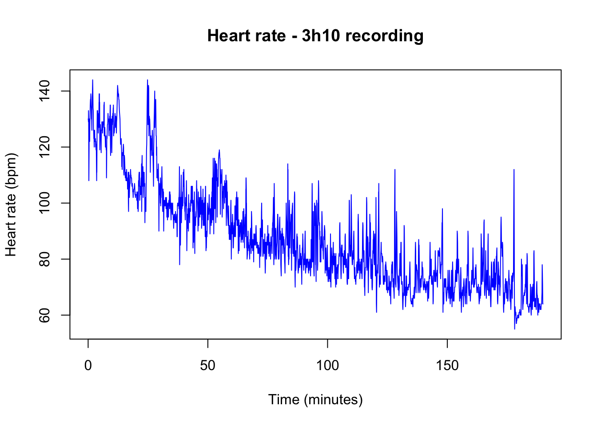{width=672}
:::

```{.r .cell-code}
# Plot the short recording
plot(pulse_short$time_min, pulse_short$value,
     type = "l",
     col = "red",
     xlab = "Time (minutes)",
     ylab = "Heart rate (bpm)",
     main = "Heart rate - 7m30 recording")
```

::: {.cell-output-display}
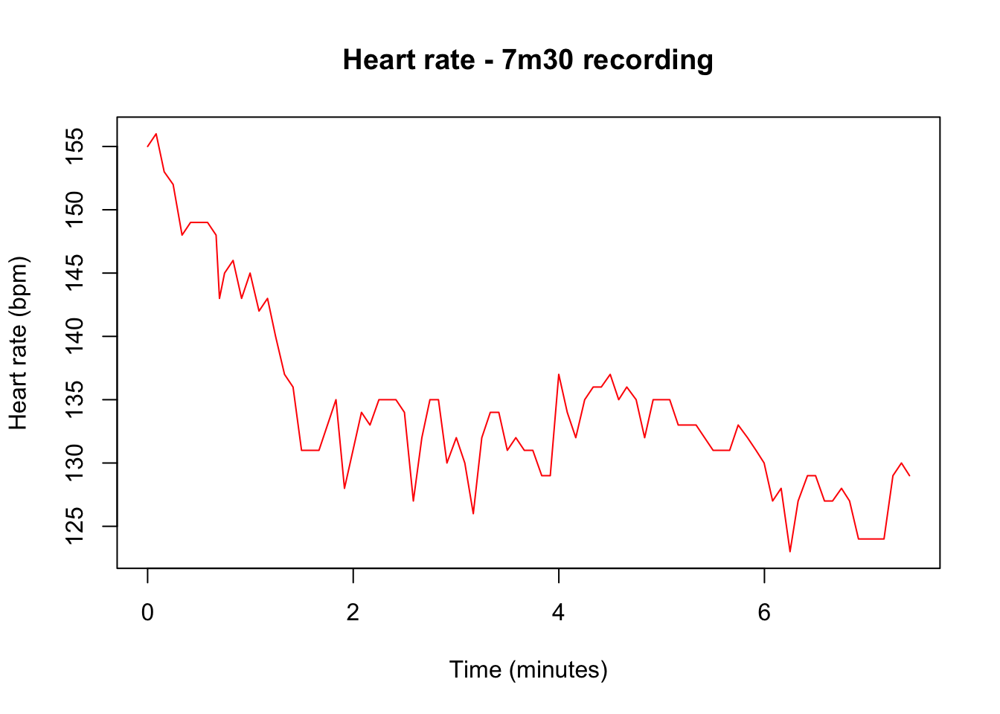{width=672}
:::
:::


::: {.cell}

```{.r .cell-code}
# Summary of the two recordings
summary(pulse_long[, c("time_min", "value")])
```

::: {.cell-output .cell-output-stdout}

```
    time_min          value       
 Min.   :  0.00   Min.   : 55.00  
 1st Qu.: 46.04   1st Qu.: 74.00  
 Median : 91.35   Median : 84.00  
 Mean   : 92.54   Mean   : 88.69  
 3rd Qu.:139.08   3rd Qu.:100.00  
 Max.   :189.96   Max.   :144.00  
```


:::

```{.r .cell-code}
summary(pulse_short[, c("time_min", "value")])
```

::: {.cell-output .cell-output-stdout}

```
    time_min         value      
 Min.   :0.000   Min.   :123.0  
 1st Qu.:1.791   1st Qu.:130.0  
 Median :3.664   Median :133.0  
 Mean   :3.674   Mean   :134.4  
 3rd Qu.:5.542   3rd Qu.:136.0  
 Max.   :7.411   Max.   :156.0  
```


:::

```{.r .cell-code}
# Check measurement intervals
summary(diff(pulse_long$time_min) * 60)
```

::: {.cell-output .cell-output-stdout}

```
   Min. 1st Qu.  Median    Mean 3rd Qu.    Max. 
  0.248   4.716   4.966   4.643   5.214  10.678 
```


:::

```{.r .cell-code}
summary(diff(pulse_short$time_min) * 60)
```

::: {.cell-output .cell-output-stdout}

```
   Min. 1st Qu.  Median    Mean 3rd Qu.    Max. 
  1.984   4.960   4.963   4.941   4.967   5.461 
```


:::
:::


::: {.cell}

```{.r .cell-code}
# Select the first 10 minutes of the long recording
recovery_long_10 <- subset(pulse_long, time_min <= 10)

# Plot the first 10 minutes
plot(recovery_long_10$time_min,
     recovery_long_10$value,
     type = "p",
     pch = 16 ,
     cex = 0.6 ,
     col = "blue",
     xlab = "Time (minutes)",
     ylab = "Heart rate (bpm)",
     main = "First 10 minutes - Long recording")
```

::: {.cell-output-display}
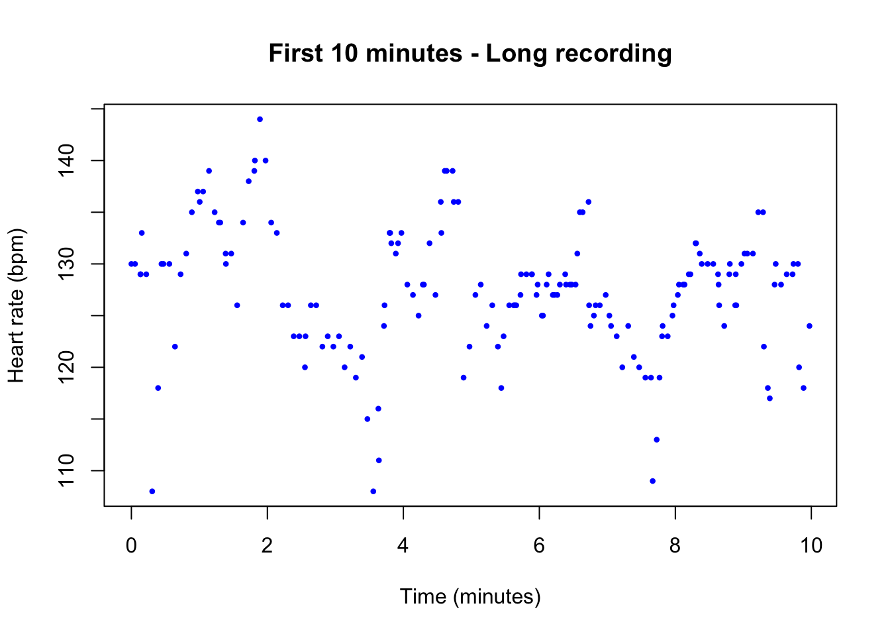{width=672}
:::

```{.r .cell-code}
# Plot the complete short recording
plot(pulse_short$time_min,
     pulse_short$value,
     type = "p",
     pch = 16 ,
     cex = 0.6 ,
     col = "red",
     xlab = "Time (minutes)",
     ylab = "Heart rate (bpm)",
     main = "Complete short recording")
```

::: {.cell-output-display}
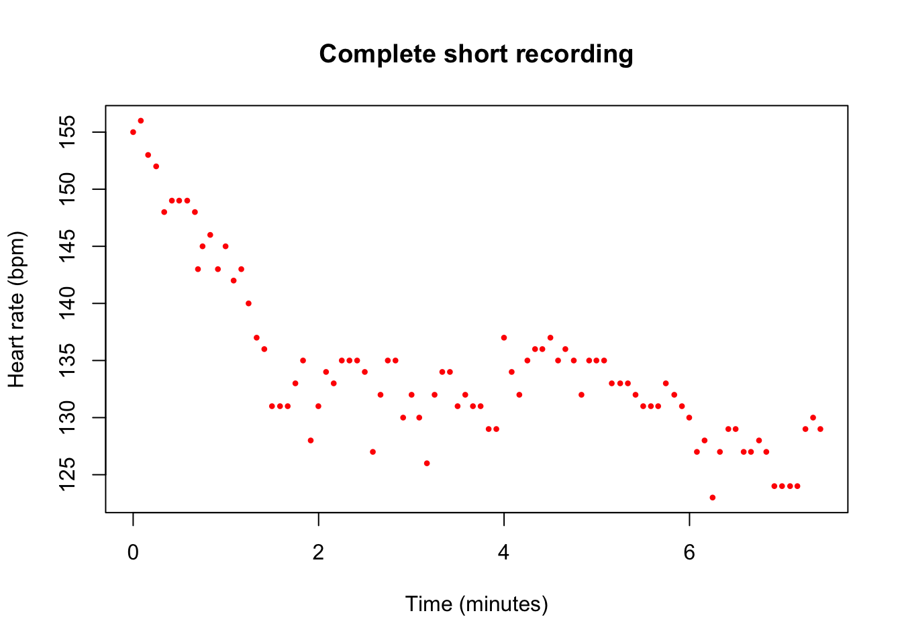{width=672}
:::
:::


::: {.cell}

```{.r .cell-code}
# Fit a linear regression to the short recording
model_linear_short <- lm(value ~ time_min, data = pulse_short)

# Display model coefficients and statistics
summary(model_linear_short)
```

::: {.cell-output .cell-output-stdout}

```

Call:
lm(formula = value ~ time_min, data = pulse_short)

Residuals:
     Min       1Q   Median       3Q      Max 
-10.8729  -3.3729   0.6019   3.3003  12.4753 

Coefficients:
            Estimate Std. Error t value Pr(>|t|)    
(Intercept) 143.7347     0.9770   147.1   <2e-16 ***
time_min     -2.5390     0.2288   -11.1   <2e-16 ***
---
Signif. codes:  0 '***' 0.001 '**' 0.01 '*' 0.05 '.' 0.1 ' ' 1

Residual standard error: 4.749 on 89 degrees of freedom
Multiple R-squared:  0.5804,	Adjusted R-squared:  0.5757 
F-statistic: 123.1 on 1 and 89 DF,  p-value: < 2.2e-16
```


:::

```{.r .cell-code}
# Plot the observed data
plot(pulse_short$time_min, pulse_short$value,
     type = "p",
     pch = 16 ,
     cex = 0.6,
     col = "red",
     xlab = "Time (minutes)",
     ylab = "Heart rate (bpm)",
     main = "Linear regression - Short recording")

# Add the fitted regression line
abline(model_linear_short, col = "blue", lwd = 2)

legend("topright",
       legend = c("Observed heart rate", "Linear model"),
       col = c("red", "blue"),
       lty = 1,
       bty = "n")
```

::: {.cell-output-display}
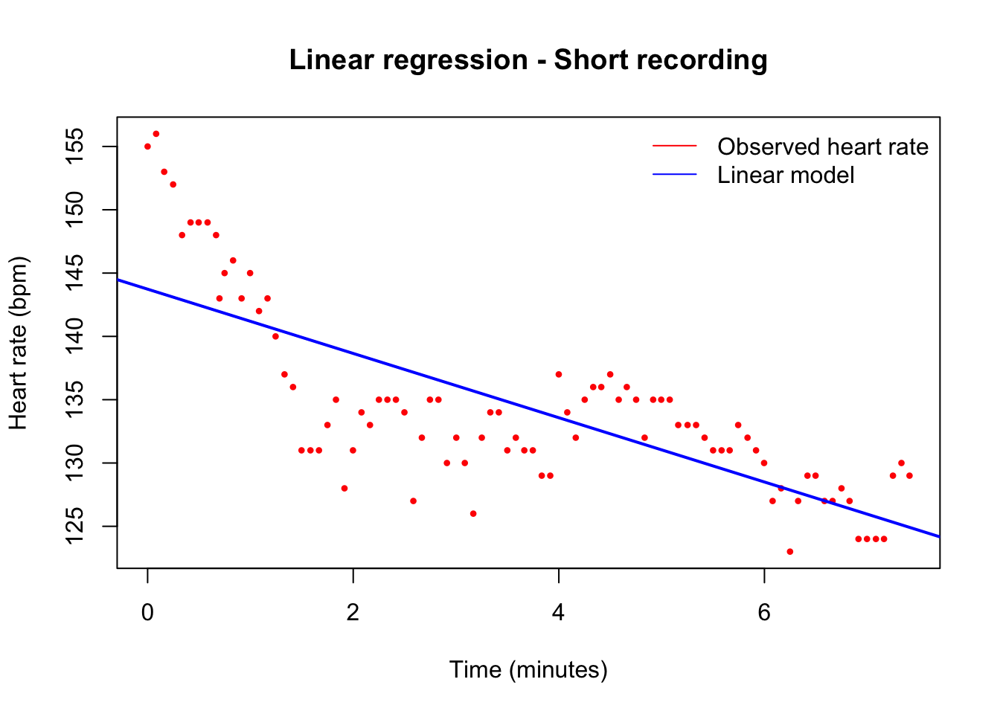{width=672}
:::
:::


::: {.cell}

```{.r .cell-code}
summary(model_linear_short)
```

::: {.cell-output .cell-output-stdout}

```

Call:
lm(formula = value ~ time_min, data = pulse_short)

Residuals:
     Min       1Q   Median       3Q      Max 
-10.8729  -3.3729   0.6019   3.3003  12.4753 

Coefficients:
            Estimate Std. Error t value Pr(>|t|)    
(Intercept) 143.7347     0.9770   147.1   <2e-16 ***
time_min     -2.5390     0.2288   -11.1   <2e-16 ***
---
Signif. codes:  0 '***' 0.001 '**' 0.01 '*' 0.05 '.' 0.1 ' ' 1

Residual standard error: 4.749 on 89 degrees of freedom
Multiple R-squared:  0.5804,	Adjusted R-squared:  0.5757 
F-statistic: 123.1 on 1 and 89 DF,  p-value: < 2.2e-16
```


:::
:::


::: {.cell}

```{.r .cell-code}
# Fit a mono-exponential model
model_exp_short <- nls(
  value ~ HR_rest + A * exp(-k * time_min),
  data = pulse_short,
  start = list(HR_rest = 125, A = 30, k = 0.8),
  algorithm = "port",
  lower = c(HR_rest = 0, A = 0, k = 0)
)

# Display estimated parameters
summary(model_exp_short)
```

::: {.cell-output .cell-output-stdout}

```

Formula: value ~ HR_rest + A * exp(-k * time_min)

Parameters:
        Estimate Std. Error t value Pr(>|t|)    
HR_rest 130.2063     0.5325 244.527  < 2e-16 ***
A        27.2357     1.7003  16.018  < 2e-16 ***
k         0.9231     0.1088   8.483 4.74e-13 ***
---
Signif. codes:  0 '***' 0.001 '**' 0.01 '*' 0.05 '.' 0.1 ' ' 1

Residual standard error: 3.322 on 88 degrees of freedom

Algorithm "port", convergence message: relative convergence (4)
```


:::

```{.r .cell-code}
# Plot observed measurements
plot(pulse_short$time_min, pulse_short$value,
     pch = 16, cex = 0.6, col = "red",
     xlab = "Time (minutes)",
     ylab = "Heart rate (bpm)",
     main = "Linear vs exponential - Short recording")

# Add linear model
abline(model_linear_short, col = "blue", lwd = 2)

# Add exponential model
lines(pulse_short$time_min,
      predict(model_exp_short),
      col = "darkgreen", lwd = 2)

legend("topright",
       legend = c("Observed data", "Linear", "Exponential"),
       col = c("red", "blue", "darkgreen"),
       pch = c(16, NA, NA),
       lty = c(NA, 1, 1),
       bty = "n")
```

::: {.cell-output-display}
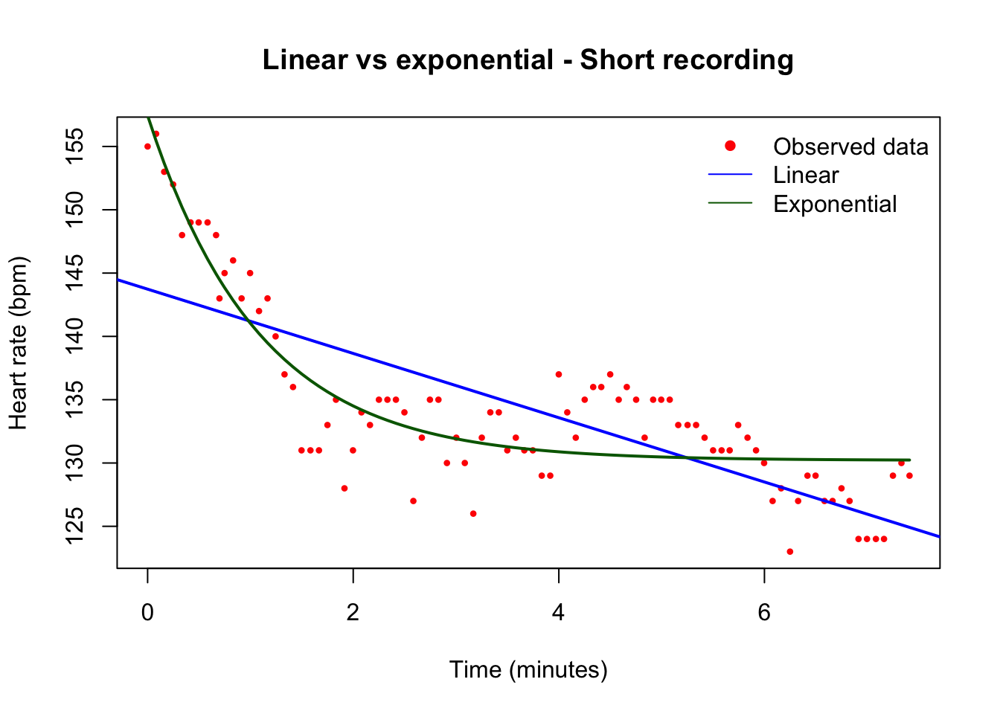{width=672}
:::
:::


::: {.cell}

```{.r .cell-code}
# Predictions from both models
pred_linear <- predict(model_linear_short)
pred_exp <- predict(model_exp_short)

# Observed heart rate
observed <- pulse_short$value

# Function to calculate model performance
model_metrics <- function(observed, predicted) {
  rmse <- sqrt(mean((observed - predicted)^2))
  r2 <- 1 - sum((observed - predicted)^2) /
    sum((observed - mean(observed))^2)

  return(c(RMSE = rmse, R_squared = r2))
}

# Compare model performance
comparison_short <- rbind(
  Linear = model_metrics(observed, pred_linear),
  Exponential = model_metrics(observed, pred_exp)
)

print(round(comparison_short, 3))
```

::: {.cell-output .cell-output-stdout}

```
             RMSE R_squared
Linear      4.697     0.580
Exponential 3.266     0.797
```


:::
:::


The mono-exponential model fits the short recording better than the linear model, with a higher R² (0.797 vs. 0.580) and a lower RMSE (3.266 vs. 4.697 bpm). This suggests that heart rate decreases rapidly at first before gradually stabilizing, rather than following a constant linear decrease.


::: {.cell}

```{.r .cell-code}
# Calculate residuals
res_linear <- residuals(model_linear_short)
res_exp <- residuals(model_exp_short)

# Compare residual patterns
par(mfrow = c(1, 2))

plot(pulse_short$time_min, res_linear,
     pch = 16, cex = 0.6, col = "blue",
     xlab = "Time (minutes)",
     ylab = "Residuals (bpm)",
     main = "Linear model residuals")
abline(h = 0, lty = 2)

plot(pulse_short$time_min, res_exp,
     pch = 16, cex = 0.6, col = "darkgreen",
     xlab = "Time (minutes)",
     ylab = "Residuals (bpm)",
     main = "Exponential model residuals")
abline(h = 0, lty = 2)
```

::: {.cell-output-display}
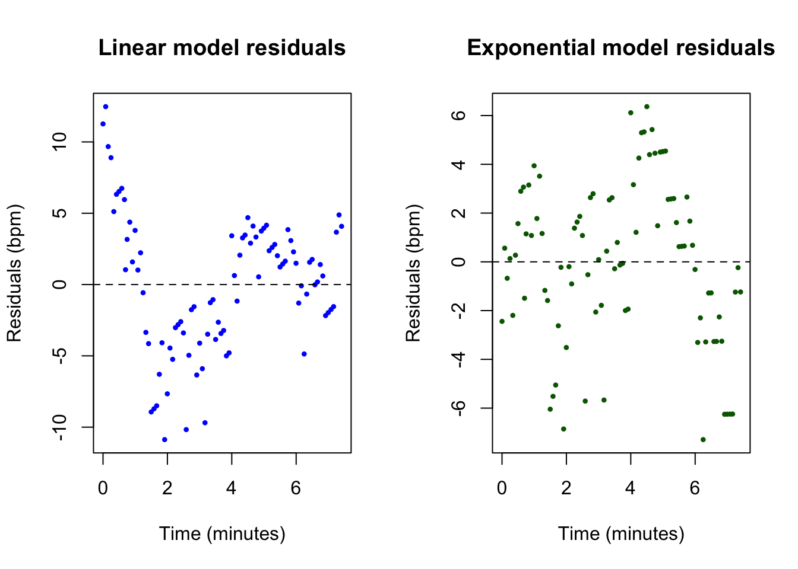{width=672}
:::

```{.r .cell-code}
par(mfrow = c(1, 1))
```
:::


The linear model residuals show a clear systematic pattern, indicating that a straight line does not adequately describe heart rate recovery. The exponential model produces smaller and less systematically distributed residuals, although some fluctuations remain. This supports the use of a nonlinear model for the short recording.


::: {.cell}

```{.r .cell-code}
# Compare model complexity using AIC
aic_comparison_short <- data.frame(
  Model = c("Linear", "Mono-exponential"),
  Parameters = c(2, 3),
  AIC = c(
    AIC(model_linear_short),
    AIC(model_exp_short)
  )
)

print(aic_comparison_short)
```

::: {.cell-output .cell-output-stdout}

```
             Model Parameters      AIC
1           Linear          2 545.7716
2 Mono-exponential          3 481.6825
```


:::

```{.r .cell-code}
summary(model_exp_short)
```

::: {.cell-output .cell-output-stdout}

```

Formula: value ~ HR_rest + A * exp(-k * time_min)

Parameters:
        Estimate Std. Error t value Pr(>|t|)    
HR_rest 130.2063     0.5325 244.527  < 2e-16 ***
A        27.2357     1.7003  16.018  < 2e-16 ***
k         0.9231     0.1088   8.483 4.74e-13 ***
---
Signif. codes:  0 '***' 0.001 '**' 0.01 '*' 0.05 '.' 0.1 ' ' 1

Residual standard error: 3.322 on 88 degrees of freedom

Algorithm "port", convergence message: relative convergence (4)
```


:::
:::


The mono-exponential model estimated an asymptotic heart rate of 130.21 bpm, an amplitude of 27.24 bpm, and a decay constant of 0.923 min⁻¹. The corresponding time constant was approximately 1.08 minutes, indicating a rapid initial decrease in heart rate followed by a slower stabilization phase. However, the estimated asymptote should not be interpreted as the participant's resting heart rate.


::: {.cell}

```{.r .cell-code}
# Smooth the long recording using a 12-point moving average
# Approximately 12 measurements x 5 seconds = 1 minute
pulse_long$hr_smooth <- as.numeric(
  stats::filter(pulse_long$value,
                rep(1 / 12, 12),
                sides = 2)
)

# Plot raw heart rate and smoothed trend
plot(pulse_long$time_min, pulse_long$value,
     type = "l", col = "lightgray",
     xlab = "Time (minutes)",
     ylab = "Heart rate (bpm)",
     main = "Long recording - Heart rate trend")

lines(pulse_long$time_min, pulse_long$hr_smooth,
      col = "blue", lwd = 2)

legend("topright",
       legend = c("Raw heart rate", "1-minute moving average"),
       col = c("lightgray", "blue"),
       lty = 1, bty = "n")
```

::: {.cell-output-display}
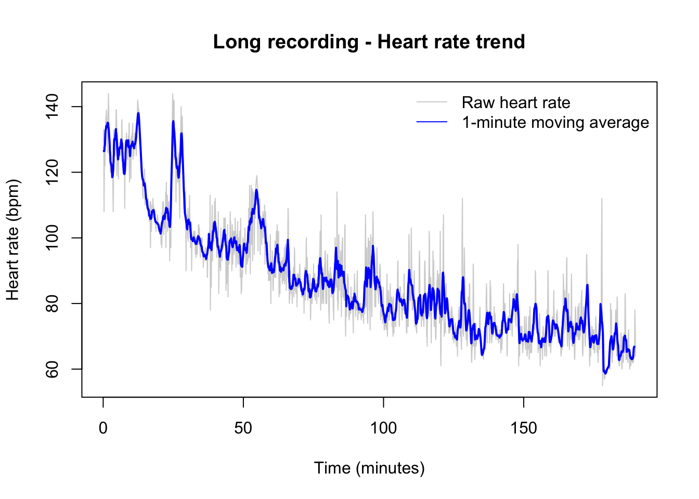{width=672}
:::
:::


::: {.cell}

```{.r .cell-code}
# Explore three periods of the long recording
windows <- list(
  c(20, 40),
  c(45, 65),
  c(85, 105)
)

par(mfrow = c(1, 3))

for (w in windows) {
  selected <- subset(
    pulse_long,
    time_min >= w[1] & time_min <= w[2]
  )

  plot(selected$time_min, selected$value,
       type = "p", pch = 16, cex = 0.4,
       col = "gray50",
       xlab = "Time (minutes)",
       ylab = "Heart rate (bpm)",
       main = paste(w[1], "-", w[2], "min"))

  lines(selected$time_min, selected$hr_smooth,
        col = "blue", lwd = 2)
}
```

::: {.cell-output-display}
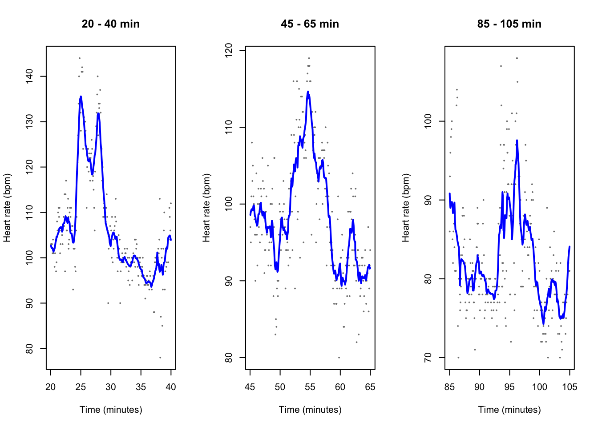{width=672}
:::

```{.r .cell-code}
par(mfrow = c(1, 1))
```
:::


::: {.cell}

```{.r .cell-code}
# Import acceleration data from the long recording
acc_long <- read.csv(unz(zip_long, "acceleration.csv"))

# Examine the structure
str(acc_long)
```

::: {.cell-output .cell-output-stdout}

```
'data.frame':	610518 obs. of  4 variables:
 $ timestamp: num  1.79e+12 1.79e+12 1.79e+12 1.79e+12 1.79e+12 ...
 $ x        : num  0.085 0.0898 0.0967 0.0981 0.0933 ...
 $ y        : num  0.964 0.991 0.99 0.979 0.984 ...
 $ z        : num  -0.159 -0.168 -0.158 -0.159 -0.184 ...
```


:::

```{.r .cell-code}
head(acc_long)
```

::: {.cell-output .cell-output-stdout}

```
     timestamp          x         y          z
1 1.790323e+12 0.08496094 0.9643555 -0.1591797
2 1.790323e+12 0.08984375 0.9912109 -0.1684570
3 1.790323e+12 0.09667969 0.9897461 -0.1577148
4 1.790323e+12 0.09814453 0.9794922 -0.1586914
5 1.790323e+12 0.09326172 0.9838867 -0.1840820
6 1.790323e+12 0.08593750 0.9843750 -0.1821289
```


:::
:::


Ok so now, after import the data acceleration, we want to know if have any relationship between the acceleration and the heart rate. 


::: {.cell}

```{.r .cell-code}
# Convert timestamps to minutes
acc_long$time_min <- (
  acc_long$timestamp - min(pulse_long$timestamp)
) / 60000

# Calculate acceleration magnitude
acc_long$magnitude <- sqrt(
  acc_long$x^2 + acc_long$y^2 + acc_long$z^2
)

# Estimate movement intensity
acc_long$movement <- c(
  NA, abs(diff(acc_long$magnitude))
)

# Select the 20-40 minute period
hr_selected <- subset(
  pulse_long, time_min >= 20 & time_min <= 40
)

acc_selected <- subset(
  acc_long, time_min >= 20 & time_min <= 40
)

# Plot heart rate as points
plot(hr_selected$time_min, hr_selected$value,
     pch = 16, cex = 0.5, col = "blue",
     xlab = "Time (minutes)",
     ylab = "Heart rate (bpm)",
     main = "Heart rate - 20 to 40 min")
```

::: {.cell-output-display}
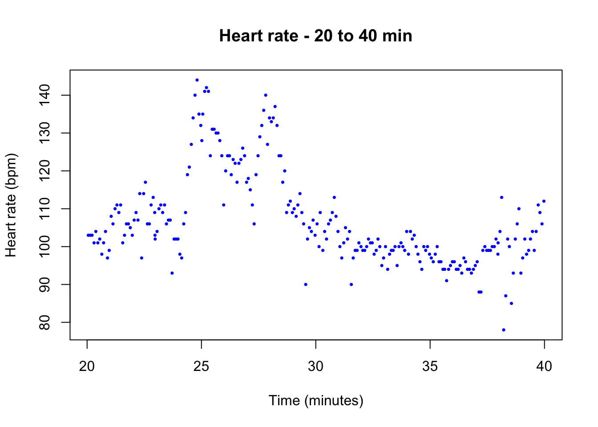{width=672}
:::

```{.r .cell-code}
# Plot movement separately
plot(acc_selected$time_min, acc_selected$movement,
     type = "l", col = "darkgreen",
     xlab = "Time (minutes)",
     ylab = "Change in acceleration magnitude",
     main = "Movement - 20 to 40 min")
```

::: {.cell-output-display}
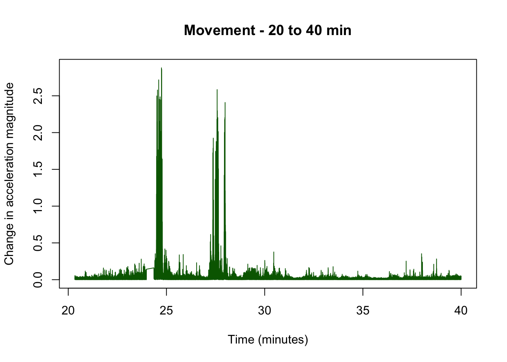{width=672}
:::
:::


::: {.cell}

```{.r .cell-code}
# Select a potential recovery period (28-35 min)
recovery_long <- subset(
  pulse_long,
  time_min >= 28 & time_min <= 35
)

# Reset time to zero at the beginning of the selected period
recovery_long$recovery_time <- (
  recovery_long$time_min - min(recovery_long$time_min)
)

# Plot the selected recovery period
plot(recovery_long$recovery_time,
     recovery_long$value,
     pch = 16, cex = 0.6, col = "blue",
     xlab = "Recovery time (minutes)",
     ylab = "Heart rate (bpm)",
     main = "Potential recovery period - Long recording")
```

::: {.cell-output-display}
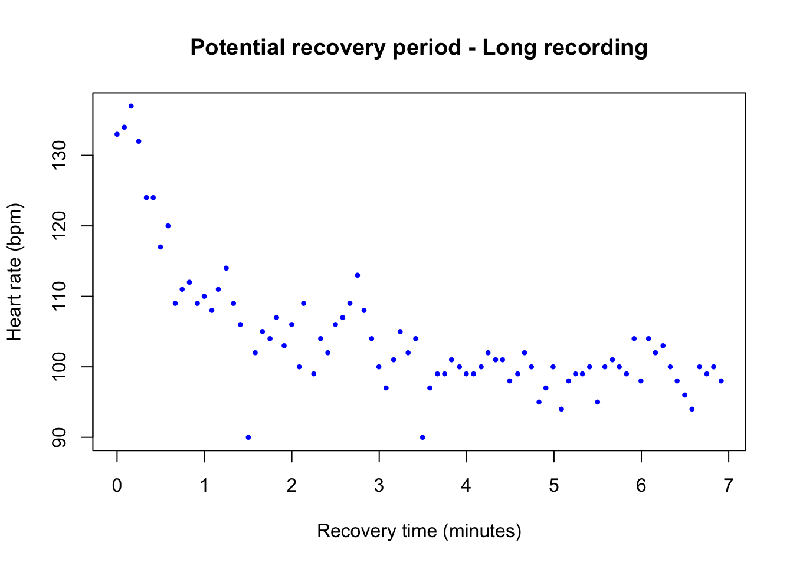{width=672}
:::
:::


For the longer recording, we examined both heart rate and acceleration data to identify a potential recovery period. Increased movement activity was observed around 24–28 minutes, followed by lower movement levels and a progressive decrease in heart rate. Therefore, the 28–35 minute interval was selected for further regression analysis, although the exact end of exercise could not be confirmed.


::: {.cell}

```{.r .cell-code}
# Linear regression - Long recording
model_linear_long <- lm(
  value ~ recovery_time,
  data = recovery_long
)

# Mono-exponential regression - Long recording
model_exp_long <- nls(
  value ~ HR_rest + A * exp(-k * recovery_time),
  data = recovery_long,
  start = list(HR_rest = 98, A = 35, k = 1),
  algorithm = "port",
  lower = c(HR_rest = 0, A = 0, k = 0)
)

# Display model summaries
summary(model_linear_long)
```

::: {.cell-output .cell-output-stdout}

```

Call:
lm(formula = value ~ recovery_time, data = recovery_long)

Residuals:
    Min      1Q  Median      3Q     Max 
-20.538  -3.708  -0.611   2.716  22.227 

Coefficients:
              Estimate Std. Error t value Pr(>|t|)    
(Intercept)   115.2829     1.4387  80.128  < 2e-16 ***
recovery_time  -3.1587     0.3595  -8.787 1.91e-13 ***
---
Signif. codes:  0 '***' 0.001 '**' 0.01 '*' 0.05 '.' 0.1 ' ' 1

Residual standard error: 6.656 on 82 degrees of freedom
Multiple R-squared:  0.485,	Adjusted R-squared:  0.4787 
F-statistic: 77.22 on 1 and 82 DF,  p-value: 1.906e-13
```


:::

```{.r .cell-code}
summary(model_exp_long)
```

::: {.cell-output .cell-output-stdout}

```

Formula: value ~ HR_rest + A * exp(-k * recovery_time)

Parameters:
        Estimate Std. Error t value Pr(>|t|)    
HR_rest  99.8212     0.5892 169.406  < 2e-16 ***
A        37.3645     2.3019  16.232  < 2e-16 ***
k         1.2383     0.1356   9.135 4.29e-14 ***
---
Signif. codes:  0 '***' 0.001 '**' 0.01 '*' 0.05 '.' 0.1 ' ' 1

Residual standard error: 3.966 on 81 degrees of freedom

Algorithm "port", convergence message: relative convergence (4)
```


:::

```{.r .cell-code}
# Plot observed data
plot(recovery_long$recovery_time,
     recovery_long$value,
     pch = 16, cex = 0.6, col = "blue",
     xlab = "Recovery time (minutes)",
     ylab = "Heart rate (bpm)",
     main = "Linear vs exponential - Long recording")

# Add linear regression
abline(model_linear_long, col = "red", lwd = 2)

# Add exponential regression
lines(recovery_long$recovery_time,
      predict(model_exp_long),
      col = "darkgreen", lwd = 2)

legend("topright",
       legend = c("Observed data", "Linear", "Exponential"),
       col = c("blue", "red", "darkgreen"),
       pch = c(16, NA, NA),
       lty = c(NA, 1, 1),
       bty = "n")
```

::: {.cell-output-display}
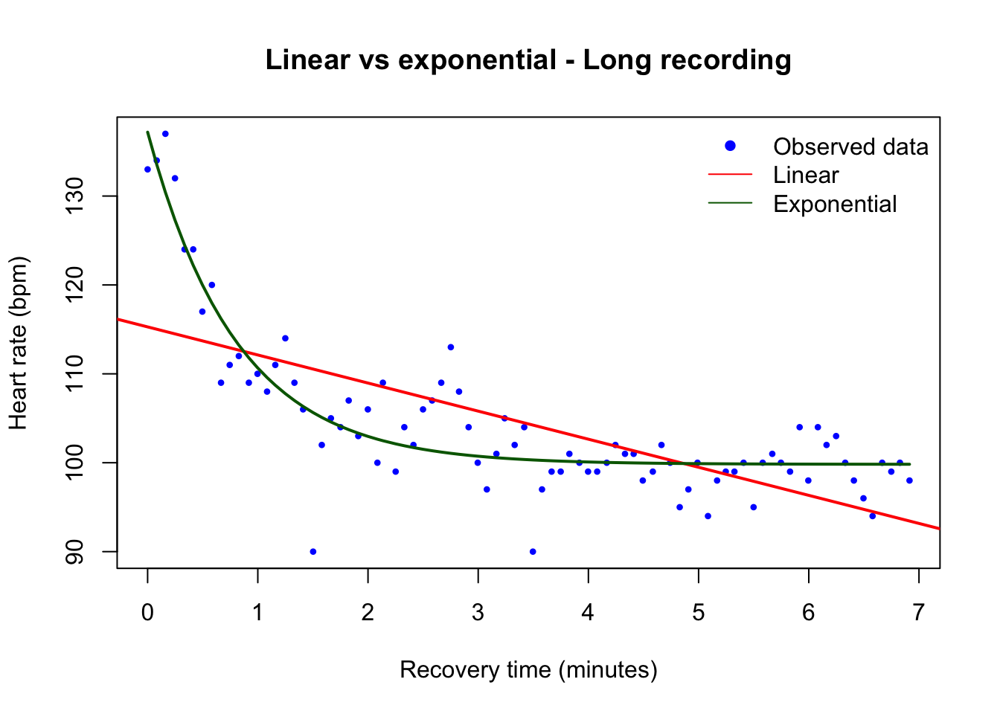{width=672}
:::
:::


For the selected 28–35 minute interval of the long recording, the mono-exponential model visually follows the initial rapid decrease in heart rate more closely than the linear model. It also captures the subsequent stabilization, although some fluctuations remain unexplained.


::: {.cell}

```{.r .cell-code}
# Predictions for the long recording
pred_linear_long <- predict(model_linear_long)
pred_exp_long <- predict(model_exp_long)

# Compare RMSE and R-squared
comparison_long <- rbind(
  Linear = model_metrics(
    recovery_long$value, pred_linear_long
  ),
  Exponential = model_metrics(
    recovery_long$value, pred_exp_long
  )
)

# Add AIC values
comparison_long <- cbind(
  comparison_long,
  AIC = c(
    AIC(model_linear_long),
    AIC(model_exp_long)
  )
)

print(round(comparison_long, 3))
```

::: {.cell-output .cell-output-stdout}

```
             RMSE R_squared     AIC
Linear      6.576     0.485 560.802
Exponential 3.894     0.819 474.785
```


:::
:::


For the selected recovery interval of the long recording, the mono-exponential model performed substantially better than the linear model. It achieved a higher R² (0.819 vs. 0.485), a lower RMSE (3.894 vs. 6.576 bpm), and a lower AIC (474.79 vs. 560.80). These results support the hypothesis that a nonlinear model better describes the observed decrease in heart rate.


::: {.cell}

```{.r .cell-code}
# Residuals for the long recording
res_linear_long <- residuals(model_linear_long)
res_exp_long <- residuals(model_exp_long)

# Plot linear model residuals
plot(recovery_long$recovery_time, res_linear_long,
     pch = 16, cex = 0.6, col = "red",
     xlab = "Recovery time (minutes)",
     ylab = "Residuals (bpm)",
     main = "Linear residuals - Long recording")
abline(h = 0, lty = 2)
```

::: {.cell-output-display}
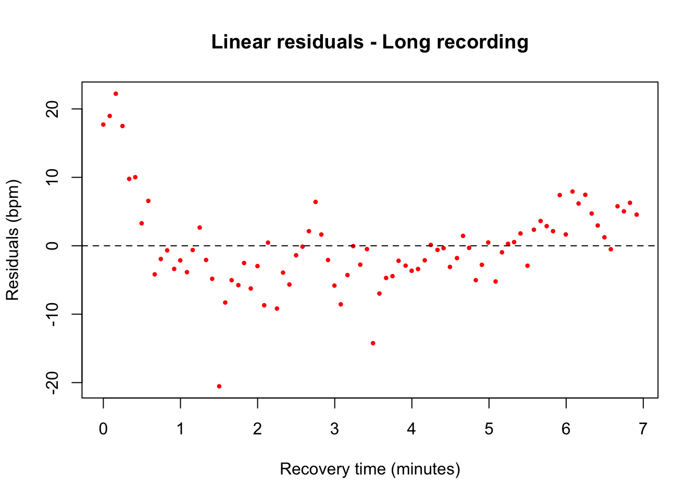{width=672}
:::

```{.r .cell-code}
# Plot exponential model residuals
plot(recovery_long$recovery_time, res_exp_long,
     pch = 16, cex = 0.6, col = "darkgreen",
     xlab = "Recovery time (minutes)",
     ylab = "Residuals (bpm)",
     main = "Exponential residuals - Long recording")
abline(h = 0, lty = 2)
```

::: {.cell-output-display}
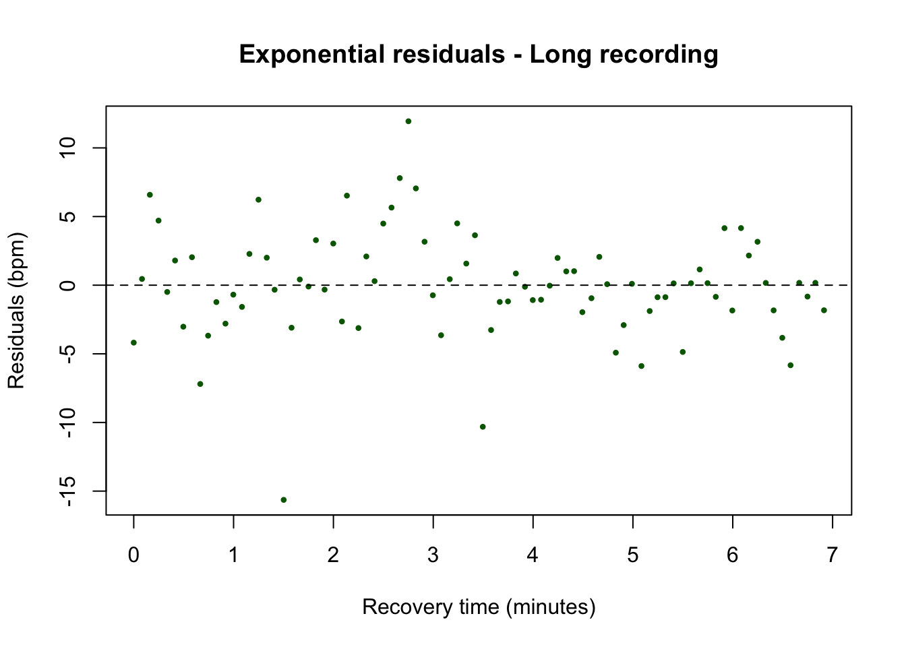{width=672}
:::
:::


The linear model residuals show a systematic curved pattern, indicating that the model does not adequately capture the shape of the heart rate decrease. In contrast, the mono-exponential model produces residuals that are more evenly distributed around zero, although some outliers and fluctuations remain. This supports the better fit of the mono-exponential model for the selected interval.


::: {.cell}

```{.r .cell-code}
summary(model_exp_long)
```

::: {.cell-output .cell-output-stdout}

```

Formula: value ~ HR_rest + A * exp(-k * recovery_time)

Parameters:
        Estimate Std. Error t value Pr(>|t|)    
HR_rest  99.8212     0.5892 169.406  < 2e-16 ***
A        37.3645     2.3019  16.232  < 2e-16 ***
k         1.2383     0.1356   9.135 4.29e-14 ***
---
Signif. codes:  0 '***' 0.001 '**' 0.01 '*' 0.05 '.' 0.1 ' ' 1

Residual standard error: 3.966 on 81 degrees of freedom

Algorithm "port", convergence message: relative convergence (4)
```


:::
:::


The mono-exponential model estimated an asymptotic heart rate of 99.82 bpm, an amplitude of 37.36 bpm, and a decay constant of 1.238 min⁻¹ for the selected interval of the long recording. The corresponding time constant was approximately 0.81 minutes, compared with 1.08 minutes for the short recording. This suggests a faster modeled decrease in heart rate during the selected long-recording interval, although differences in exercise conditions and recovery-period identification prevent direct conclusions about physiological recovery capacity.


::: {.cell}

```{.r .cell-code}
# Try several starting values for the bi-exponential model
starts <- list(
  c(128, 18, 2, 10, 0.3),
  c(125, 20, 1.5, 10, 0.1),
  c(130, 15, 3, 12, 0.5),
  c(125, 25, 1, 5, 0.1)
)

model_biexp_short <- NULL

for (s in starts) {
  fit <- try(
    nls(
      value ~ HR_rest + A1 * exp(-k1 * time_min) +
        A2 * exp(-k2 * time_min),
      data = pulse_short,
      start = as.list(setNames(
        s, c("HR_rest", "A1", "k1", "A2", "k2")
      )),
      algorithm = "port",
      lower = c(0, 0, 0, 0, 0),
      control = nls.control(maxiter = 500, warnOnly = TRUE)
    ),
    silent = TRUE
  )

  if (!inherits(fit, "try-error") &&
      isTRUE(fit$convInfo$isConv)) {
    model_biexp_short <- fit
    break
  }
}

if (is.null(model_biexp_short)) {
  cat("No bi-exponential fit converged.\n")
} else {
  print(summary(model_biexp_short))
  print(AIC(model_biexp_short))
}
```

::: {.cell-output .cell-output-stdout}

```

Formula: value ~ HR_rest + A1 * exp(-k1 * time_min) + A2 * exp(-k2 * time_min)

Parameters:
         Estimate Std. Error t value Pr(>|t|)    
HR_rest 0.000e+00  1.002e+04   0.000 1.000000    
A1      2.315e+01  6.477e+00   3.574 0.000579 ***
k1      1.321e+00  5.295e-01   2.494 0.014550 *  
A2      1.354e+02  1.001e+04   0.014 0.989247    
k2      7.152e-03  5.496e-01   0.013 0.989648    
---
Signif. codes:  0 '***' 0.001 '**' 0.01 '*' 0.05 '.' 0.1 ' ' 1

Residual standard error: 3.203 on 86 degrees of freedom

Algorithm "port", convergence message: relative convergence (4)

[1] 476.9648
```


:::
:::


The bi-exponential model achieved a slightly lower AIC than the mono-exponential model (476.96 vs. 481.68). However, its parameters were poorly identified, with an estimated asymptotic heart rate of 0 bpm and very large standard errors for several parameters. Therefore, despite the improved statistical fit, the mono-exponential model was considered more appropriate for physiological interpretation because of its greater simplicity and more plausible parameter estimates.


::: {.cell}

```{.r .cell-code}
model_metrics(
  pulse_short$value,
  predict(model_biexp_short)
)
```

::: {.cell-output .cell-output-stdout}

```
     RMSE R_squared 
3.1137042 0.8155796 
```


:::
:::


## Draw a conclusion 

Our results generally support our initial hypotheses.

H1 and H2 were supported: the mono-exponential model performed better than the linear model for both recordings. For the short recording, R² increased from 0.580 to 0.797, while RMSE decreased from 4.697 to 3.266 bpm. Similar results were observed for the selected period of the long recording, where R² increased from 0.485 to 0.819. The graphs and residuals also showed that the exponential model better represented the shape of the heart rate decrease.

H3 was partially supported: the bi-exponential model slightly improved the statistical results for the short recording (R² = 0.816 and AIC = 476.96). However, some estimated parameters were not physiologically realistic. Therefore, the additional complexity was not justified for physiological interpretation.

H4 was not clearly supported: although the two recordings showed different heart rate patterns and recovery speeds, the mono-exponential model performed well in both selected periods. We therefore did not find evidence that different mathematical models were necessary.

The graphs suggest a rapid initial decrease in heart rate followed by a slower phase. This is consistent with the recovery patterns discussed by Bartels et al. (2018) [@bartels2018]. However, our analysis does not allow us to confirm two distinct physiological recovery mechanisms.

Our results are also consistent with Bartels-Ferreira et al. (2015) [@bartelsferreira2015], who investigated mono-exponential modeling of heart rate recovery.

There are several limitations. First, the exact end of exercise was unknown, especially for the long recording. We selected the 28–35 minute period using heart rate and acceleration data, but we cannot confirm that it represents the complete recovery. Second, the exercise conditions were not standardized between recordings. Finally, some fluctuations remained unexplained by our models.

Overall, we would choose the mono-exponential model to describe heart rate recovery after exercise. It provided a good statistical fit for both analyzed periods, with more interpretable parameters than the bi-exponential model. This choice is supported by our experimental results and the scientific literature. However, further recordings with clearly identified exercise and recovery periods would be necessary to confirm our conclusions.


# Git workflow


